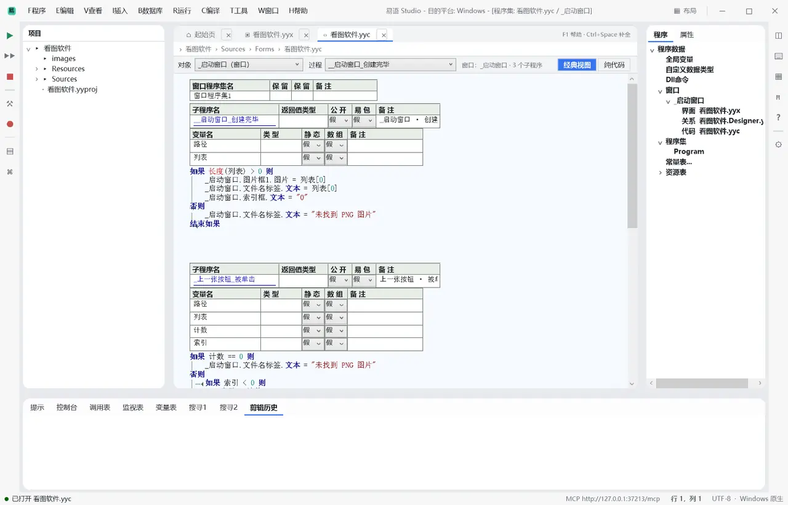
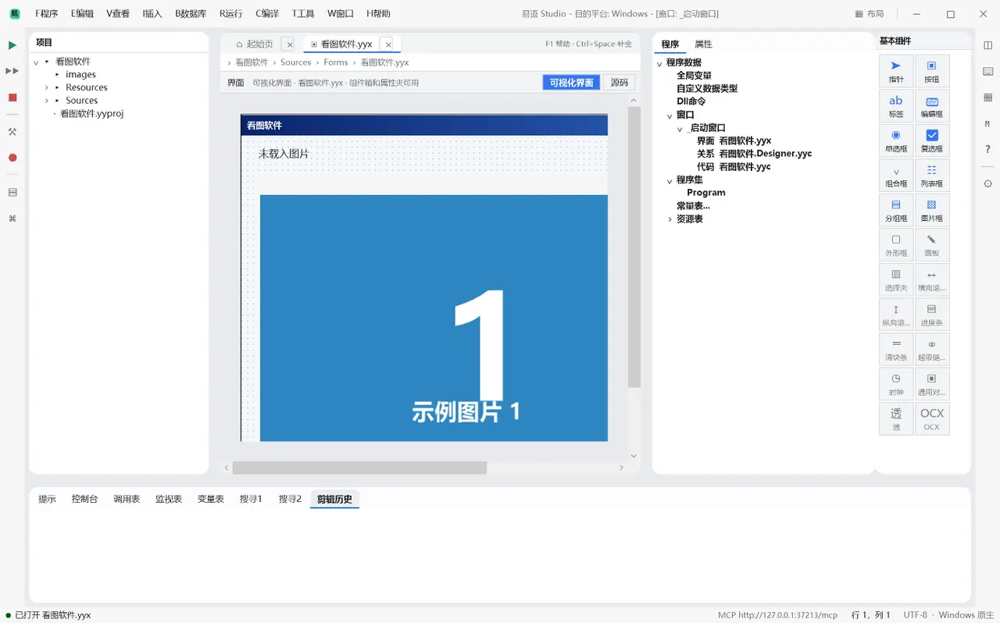
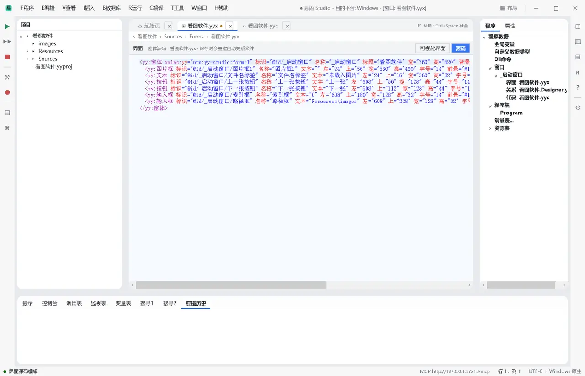
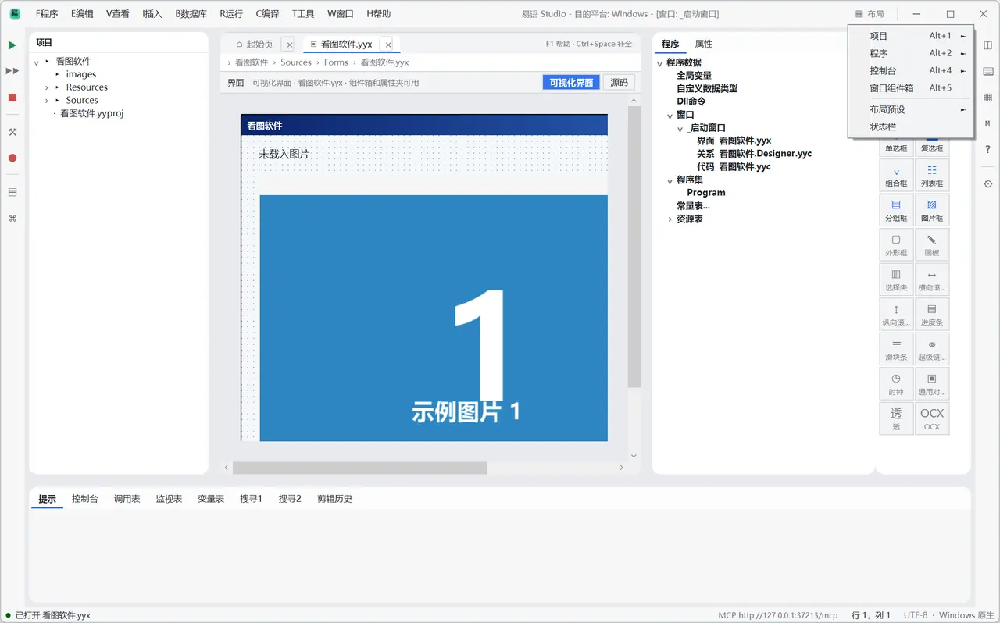
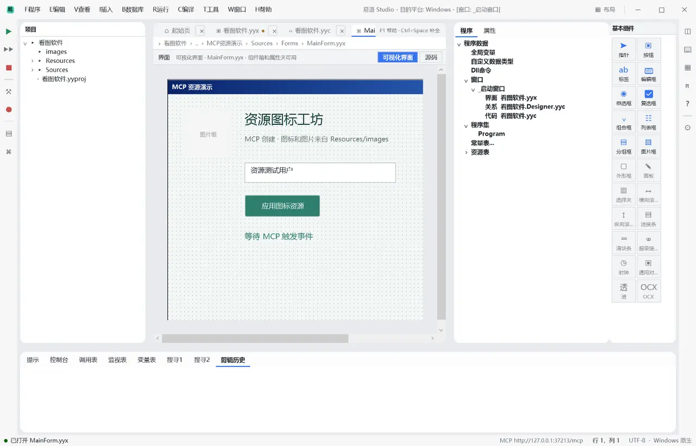
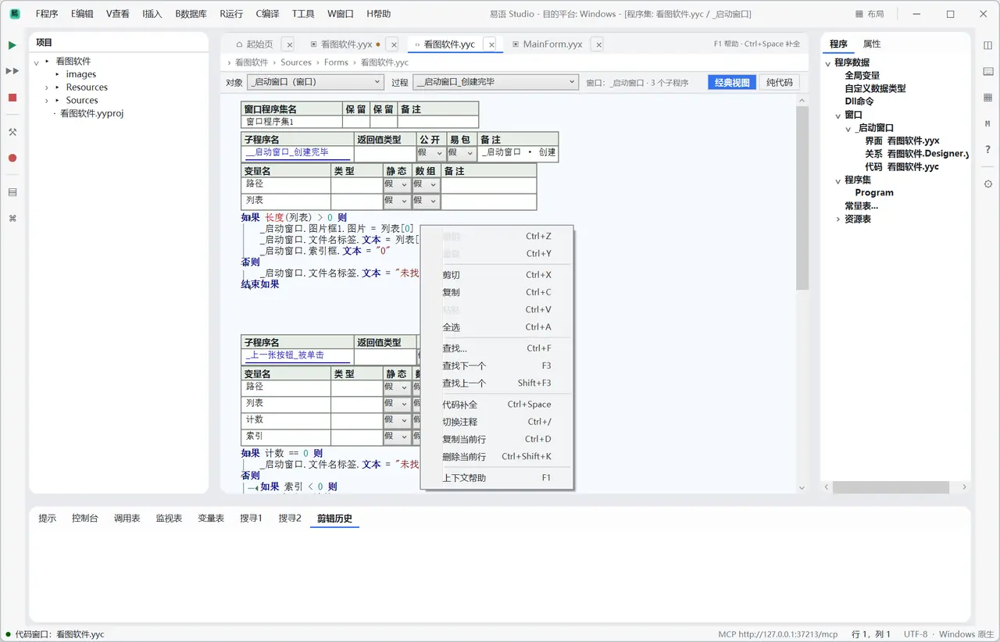
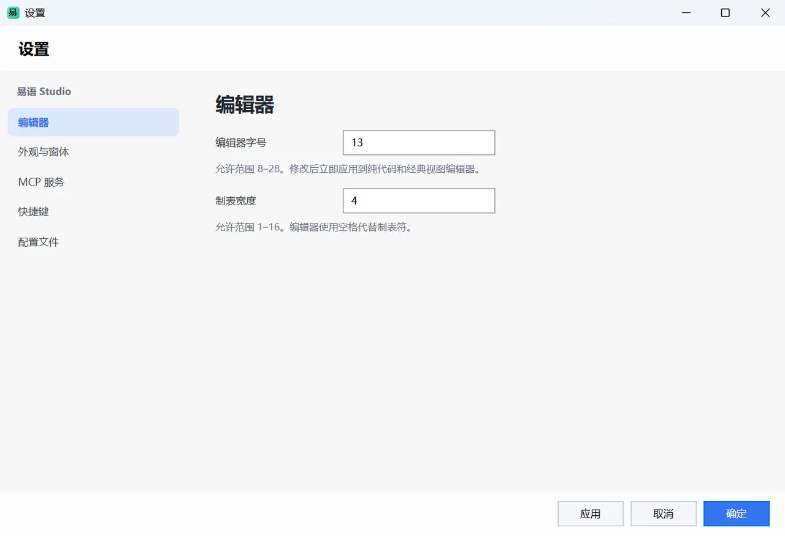

# 易语 Studio

易语 Studio 是一个中文桌面开发环境，以现代 IDE 技术重制易语言的开发体验，把界面设计、中文代码编辑、项目管理和应用编译整合在同一个工作区。Windows IDE 已可用；macOS Apple Silicon 已能通过同一套公共代码和独立 ARM64/Mach-O 后端构建并运行控制台程序与常用 AppKit 窗体，AppKit Studio 宿主仍在开发。

项目正在持续开发中，语言能力、文件格式和 IDE 交互都会继续调整。

## 界面

工作区采用现代浅色 IDE 布局：

- 菜单、当前文档标题和窗口按钮共用无系统标题栏的顶部操作栏，窗口仍支持拖动、缩放、双击最大化和贴边布局。
- 顶栏“布局”入口和“查看 → 工具窗口”采用 IDEA 式管理：项目、程序/属性、控制台可移动、最小化或隐藏，最小化后保留恢复栏。
- 左侧显示真实项目目录，可直接展开文件夹、打开窗体、代码和项目文件。
- 右侧只保留程序数据和属性工具窗口；语言、系统 SDK 与命令参考统一从“帮助 → 易语开发文档”打开。
- 工作区采用 IDEA 式无缝工作台面，面板内容使用内圆角裁切，顶栏、左右常驻操作轨和窗口外缘不重复描边；项目树、编辑区和右侧工具窗位于上半区，底部工具窗口横跨整个内容宽度。左侧放运行、停止、编译、断点和项目开关，右侧放程序/属性、控制台、组件箱、MCP、帮助和设置。
- 起始页、新建程序、新建项目、设置、项目属性和开发文档统一采用白色圆角卡片、浅灰背景和亮蓝主操作，不再混用旧版蓝色横幅与深色方框。
- 默认布局由左侧项目、右侧程序/属性和底部控制台形成 IDEA 式包围结构；工具窗可移动、最小化或隐藏。
- 组件箱只在窗体设计器中显示，不会占用代码编辑空间。
- 文档标签位于编辑器顶部，并显示项目路径和当前过程面包屑。
- 状态栏显示运行状态、实际 MCP 地址、光标位置和文件编码；点击 MCP 地址可复制。
- 代码编辑支持自动补全、参数签名提示、F1 上下文帮助、括号配对、块缩进、折叠和撤销。

### 经典视图

每个子程序使用一张紧凑的方法声明表，代码正文在表格下方连续编辑。支持对象/过程导航、语法着色、参数提示、补全和块缩进。



### 窗体设计器

窗体设计器支持组件拖放、属性编辑、画布对齐和事件入口；`F5` 编译并运行原生窗口，`Ctrl+Enter` 打开设计预览。



同一个 `.yyx` 文件可在“可视化界面”和“源码”之间切换。源码模式直接编辑 XML，切回可视化模式时解析界面并保留仍兼容的控件事件关系。



### IDEA 式窗口布局

顶栏“布局”入口和“查看 → 工具窗口”支持移动、最小化、隐藏项目、程序/属性与控制台。最小化后保留侧边或底边恢复栏；定义会自动保存到 `YyStudio.json`。



### MCP 资源示例

下面的界面通过 MCP 接口从空白工程创建：导入窗口图标和图片资源、布局控件、写入按钮事件并运行预览。



## 当前能力

- Windows IDE 使用 WPF 原生窗口，无 Electron、无 WebView；Windows 编译产物使用自研 Win64/Win32 后端。
- macOS Apple Silicon 使用自研 ARM64/Mach-O 后端，通过 libSystem 调用系统接口并内嵌 ad-hoc 签名；AppKit 标签、输入框（含多行）、按钮、复选框、单选框、下拉框、列表框、分组框、图片框和主题色已可用，Studio 宿主开发中。
- 编辑器与命令行编译器分离：`YyStudio.exe` 负责 IDE，`yy.exe` / `yy` 负责构建、检查和运行。
- 中文标识符、函数、递归、默认参数、类型标注、数组、对象和异常处理。
- 结构体字段声明、对象字面量构造、接口契约和结构体实现声明。
- AST 解析器、IDE 解释执行器、Win64 与 ARM64 机器码生成器、平台后端注册表和跨文件诊断。
- `.yyproj` 项目管理、模块引入、资源表、常量表和数据表。
- 新建项目必须填写项目名和包名，源码固定在 `Sources/`，资源固定在 `Resources/`。
- 源码子目录可按 `引入 "项目包名.子目录"` 作为目录包导入。
- 可视化窗体设计、组件箱、属性夹、事件绑定、设计预览和 F5 原生运行。
- 三文件界面模型：`.yyx` 界面、`.Designer.yyc` 自动关系、`.yyc` 用户代码。
- 系统 SDK 以 `sdk/Sources` 下与包名对应的 `.yyc` 源码为公开契约；语言核心包默认引用。
- 自动关系文件使用 `文件`、`界面`、`事件` 三个易语结构体和 `@id/...` 标识，不使用 XML 保存事件。
- 多窗口采用 VS/MFC 式拥有者、模态、参数和结果模型；A 不再直接修改 B 的控件。
- JDK 式系统 SDK 包边界、`导入包` 上下文补全和 Swing 式跨 UI 技术契约。
- 默认“经典视图”和“纯代码”模式共用同一份用户代码。
- 项目可编译为不依赖 .NET、CLR、WPF 或 CRT 的 Win64 单文件 EXE，或可执行的 arm64 Mach-O 控制台/AppKit 窗体。
- `yy build` 直接使用自研原生后端，顶层语句作为隐式主程序。
- 单代码库多目标：`auto`、`windows-x64`、`macos-arm64`、`macos-x64`，按参数或宿主系统选择后端；未注册目标会明确报错。
- 平台后端通过 `INativeBackend` 注册，共享类型推断、栈槽和值布局，新增系统不需要复制语言语义。
- 条件、`当`循环、`计次循环`、`遍历`、`跳出`和`继续`。
- JSON、文本、集合、文件、时间等内置命令。
- UTF-8 文件、行列诊断、运行控制台和可取消执行。

功能规划和边界见 [路线图](docs/roadmap.md) 与 [能力核对](docs/feature-analysis.md)。

## 运行

Windows 宿主需要 .NET 10 SDK 与 Windows 10/11。macOS 使用 .NET 10；当前可以构建并运行控制台程序和常用 AppKit 窗体，Studio 的 AppKit 宿主仍在开发。

macOS Apple Silicon 构建和运行控制台示例：

```bash
dotnet build Eyuyan.slnx
dotnet run --project tools/Yy.Cli -- build examples/Sources/原生入门.yyc -o Dist/原生入门
./Dist/原生入门
```

`auto` 在 Apple Silicon 上解析为 `macos-arm64`。Windows 产物仍可在 macOS 上通过 `--target windows-x64` 交叉编译。窗体工程可以使用常用 AppKit 控件、多行输入框、事件和主题色；最大长度和窗口图标当前未实现。

macOS 目前没有 Studio 宿主：`dotnet build` 在 macOS 上会编译 WPF 工程以便 CI 检查，但 `YyStudio` 只能在 Windows 运行。后续 AppKit Studio 宿主和 `.app` 打包按 [macOS 原生支持路线](docs/macos.md) 推进。

Windows 上的完整验证与发布使用 `.\build.ps1`；macOS/Linux 使用 `./build.sh`，见 [构建发布版](#构建发布版)。

```powershell
dotnet run --project .\src\Yy.Studio\Yy.Studio.csproj
```

打开 `examples` 文件夹即可加载示例工程。

默认快捷键如下，均可在 `YyStudio.json` 或设置窗口中修改：

- `F5`：编译并运行当前工程；没有工程时运行当前源码。
- `Ctrl+F5`：运行项目。
- `Shift+F5`：停止运行。
- `Ctrl+B`：编译项目。
- `Ctrl+S`：保存。
- `Ctrl+W`：关闭当前标签。
- `Ctrl+Space`：代码补全。
- `F1`：当前位置的函数、命令、参数或变量帮助。
- `Ctrl+Alt+L`：格式化当前纯代码文件。
- `Ctrl+/`：切换当前行或所选行的注释。
- `Ctrl+D`：复制当前行或所选内容。
- `Ctrl+Shift+K`：删除当前行或所选内容。
- `Alt+1`：项目；`Alt+2`：程序；`Alt+3`：属性；`Alt+4`：控制台；`Alt+5`：窗口组件箱。

代码窗口右上角可切换“经典视图”和“纯代码”。
纯代码和经典视图正文支持 IDEA 式右键菜单，包含撤销、剪贴板、查找、补全、行编辑和上下文帮助；纯代码菜单额外提供“格式化代码”。



新建项目请按 `Ctrl+Alt+N`，或在“程序 → 新建”选择窗口/控制台/模块。确认类型后必须先填写项目位置、项目名和包名；Studio 创建磁盘工程后才进入 IDE。源码与资源分别写入 `Sources/`、`Resources/`，详见 [项目结构](docs/projects.md) 和 [界面架构](docs/architecture.md)。

### IDE 开发流程

1. 新建工程时先选择窗口、控制台或模块类型，再填写保存位置、项目名和包名。
2. 左侧项目树浏览 `Sources/` 与 `Resources/`；右侧只显示“程序”和“属性”，组件箱仅在窗体设计器中显示。
3. 打开 `.yyx` 设计界面，双击控件生成事件。事件入口和用户逻辑写入同名 `.yyc`，`@id/...` 映射只写入自动生成的 `.Designer.yyc`。
4. 代码默认以“经典视图”打开，可切换到“纯代码”；用户代码使用 `_启动窗口.结果标签.文本`、`_启动窗口.标题`。
5. 按 `F5` 编译并运行当前工程，底部“控制台”自动展开并显示产物、PID、标准输出和退出码。
6. 需要仅检查界面效果时按 `Ctrl+Enter` 打开设计预览；发布前按 `Ctrl+B` 生成独立原生 EXE。

### A/B 双窗口示例

`examples/窗口交互/` 演示模态窗口结果：A 显示文字，点击“修改文字”打开 B；B 从参数初始化编辑框，确认后返回结果，取消或系统关闭按钮不提交。

```text
' A 窗口：打开 B，并带入当前文字
子程序 _修改按钮_被单击()
    _修改窗口.参数 = _启动窗口.内容标签.文本
    如果 打开窗口("@id/_修改窗口", "@id/_启动窗口") 则
        _启动窗口.内容标签.文本 = _修改窗口.结果
    结束如果
结束子程序

' B 窗口：每次打开初始化草稿，确认后返回结果
子程序 _修改窗口_打开()
    _修改窗口.内容输入框.文本 = _修改窗口.参数
结束子程序

子程序 _确认按钮_被单击()
    _修改窗口.结果 = _修改窗口.内容输入框.文本
    关闭窗口("@id/_修改窗口", 真)
结束子程序
```

```powershell
yy check .\examples\窗口交互
yy run .\examples\窗口交互
```

三个生成结构体把界面文件、控件稳定标识和事件入口分开保存，用户 `.yyc` 只保留窗体名、控件名、属性和业务逻辑。

## 命令行工具

`yy` 是不加载 WPF 和 IDE 的命令行编译器。开发时可以直接运行：

```powershell
dotnet run --project .\tools\Yy.Cli -- check .\examples\原生窗体
dotnet run --project .\tools\Yy.Cli -- check .\examples\窗口交互
dotnet run --project .\tools\Yy.Cli -- build .\examples\原生窗体 -o .\artifacts\原生窗体.exe
dotnet run --project .\tools\Yy.Cli -- build .\examples\Sources\原生入门.yyc -o .\artifacts\原生入门.exe
dotnet run --project .\tools\Yy.Cli -- run .\examples\MCP资源演示
```

发布后使用 `yy.exe`：

```powershell
yy build <源码.yyc|工程.yyproj|目录> [--target <目标>] [-o 输出]
yy check <工程.yyproj|目录>
yy run <工程.yyproj|目录>
```

构建目标包括 `auto`、`windows-x64`、`macos-arm64`、`macos-x64`。未指定 `--target` 时按当前系统选择；工程清单也可记录默认 `目标平台`。Windows 原生后端生成 Win32/PE32+；macOS arm64 后端生成可执行 Mach-O 控制台和常用 AppKit 窗体程序，`macos-x64` 和 Studio 宿主仍在开发中。后端通过注册表选择，未注册目标会直接报错。完整设计见 [跨平台原生架构](docs/cross-platform.md) 与 [原生后端架构](docs/backend-architecture.md)。

`YyStudio.exe` 仅负责可视化编辑和 IDE 内操作；脚本、CI 和批处理可直接调用 `yy.exe`。命令行编译目前需要开发机安装 .NET 10 SDK。

`yy build` 直接调用自研后端，不经过 C#、C++、Rust 或 LLVM。顶层语句就是隐式主程序，不需要声明 `main`。两个后端共享类型推断、栈槽模型和值布局：

- Windows：文本/整数输出、动态文本、基础数组与对象、文件读写、目录列举、子进程、变量、算术、控制流、基础子程序，以及 Win32 原生窗口、VS 式模态拥有者与窗口结果、动态控件文本、PNG/JPEG 图片框和按钮事件。
- macOS arm64：同样的控制台语言核心、文本/数组/对象、文件读写、目录列举、子进程和退出码；窗体工程支持常用 AppKit 控件、模态窗口和事件，产物为内嵌签名的 Mach-O。

JSON、异常、编译期图片资源嵌入、AppKit 最大长度和 Studio 宿主仍在补齐；未实现能力会直接给出编译诊断，不会回退到 C#/WPF。详见 [原生后端](docs/native-backend.md) 与 [后端架构](docs/backend-architecture.md)。

## 系统 SDK 与包导入

`Yy.Sdk` 借鉴 Java/Android 的分层方式。`系统.基础`、`系统.集合`、`系统.文本`、`系统.数据`是语言核心包；`系统.界面`、`系统.文件`是调用操作系统的平台 SDK 包。源码使用统一语法声明依赖：

```text
.程序集 包示例

导入包 "系统.基础"
导入包 "系统.集合"
导入包 "系统.文本"
导入包 "系统.数据"
导入包 "系统.界面"
导入包 "系统.文件"

_启动窗口.保存按钮.文本 = "已保存"
_启动窗口.标题 = "客户管理 · 已保存"
```

界面契约借鉴 Swing 的分层方式，将窗体上下文、界面元素、窗口和控件与 WPF 实现分离。`@id/...` 映射由 `.Designer.yyc` 自动维护，用户代码使用窗体结构体、控件成员和属性。语言核心由编译器/运行时自身实现，平台 SDK 只负责系统适配。SDK 版本为 `1`，目前 7 个包可供导入；内存、编码、诊断、序列化、动态库、安全、HTTP/TLS/Socket/WebSocket、包管理和自举工具链已登记为规划包。语言核心包默认引用，平台包显式导入，规划包在实现完成前不能被导入。每个系统包都在 `sdk/Sources` 提供对应 `.yyc` 公开声明源码。完整设计见 [系统 SDK](docs/sdk.md)。

系统包与项目源码目录包使用不同关键字：`导入包 "系统.界面"` 引入 SDK，`引入 "demo.tools"` 引入当前项目 `Sources/tools` 目录包。

## Studio 配置

Studio 的可编辑配置保存在 `%APPDATA%\YyStudio\YyStudio.json`。首次启动会自动生成，也可通过“工具 → 打开 Studio 配置文件”直接编辑，完整模板见 [YyStudio.example.json](YyStudio.example.json)。

配置文件覆盖：

- MCP 启用状态、端口、自动寻找端口和尝试次数。
- 编辑器字号、制表宽度和窗体吸附网格。
- 工具窗口停靠位置、显示状态、尺寸、状态栏和布局预设。
- 新建、打开、保存、编译、运行、调试、补全、帮助、注释和行编辑快捷键。

设置窗口采用 JetBrains 风格双栏布局。也可以在启动时指定配置：



```powershell
YyStudio.exe --config D:\Config\YyStudio.json --mcp-port 38400
```

详细格式、校验规则和配置优先级见 [Studio 配置](docs/configuration.md)。

## MCP 接口

Studio 内置 MCP（Model Context Protocol）服务端，AI 客户端可以读取 IDE 状态、打开和保存工程、编辑窗体、创建事件、写入子程序、打开设计预览并触发界面交互。每个 MCP 工具都调用 Studio 的真实编辑流程，与用户在界面中的操作使用同一套代码路径。

IDE 启动后默认在 `http://127.0.0.1:37213/mcp` 提供 HTTP JSON-RPC 接口。默认端口可以在 `YyStudio.json` 中修改，或通过 `--mcp-port` 临时覆盖；项目根目录的 `.mcp.json` 使用默认端点：

```json
{
  "mcpServers": {
    "yy-studio": {
      "type": "http",
      "url": "http://127.0.0.1:37213/mcp"
    }
  }
}
```

如果默认端口被占用，服务会依次尝试后续端口，并将实际端口写入 `%TEMP%\yystudio-mcp.port`。也可以使用标准输入输出传输：

```powershell
YyStudio.exe --mcp-stdio
```

当前提供 19 个工具，覆盖工程创建、资源导入、窗体设计、控件与事件、代码读写、预览运行、控件交互和界面截图。完整参数、请求示例和返回说明见 [MCP 接口文档](docs/mcp.md)。

## 构建发布版

Windows：

```powershell
.\build.ps1
```

macOS / Linux：

```bash
./build.sh
```

发布结果：

```text
artifacts/publish/YyStudio/YyStudio.exe      # Windows IDE
artifacts/publish/yy/yy.exe                  # Windows CLI
artifacts/publish/yy-osx-arm64/yy            # macOS CLI（随宿主变化）
artifacts/samples/原生入门.exe
artifacts/samples/原生窗体.exe
artifacts/samples/原生入门.macos-arm64
artifacts/samples/原生窗体.macos-arm64
```

Windows 脚本运行语言、SDK、后端和 Studio 烟雾测试，然后生成 Windows x64 自包含版本。`build.sh` 构建完整解决方案，运行跨平台测试，编译 Windows/macOS 示例并发布当前系统的 CLI。

若目标机器已安装 .NET 10 Desktop Runtime，可以生成体积更小的版本：

```powershell
.\build-lite.ps1
```

输出包含 `artifacts\publish\YyStudio-lite\YyStudio.exe` 和
`artifacts\publish\yy-lite\yy.exe`。框架依赖仅指 IDE 和命令行工具自身；它们生成的用户程序仍然是独立的原生 EXE。

## 工程结构

新建项目的固定结构如下：

```text
DemoProject/
├─ DemoProject.yyproj
├─ Sources/
│  ├─ Program.yyc            项目入口
│  ├─ Forms/
│  │  ├─ MainForm.yyx        界面与布局
│  │  ├─ MainForm.Designer.yyc 自动生成关系
│  │  └─ MainForm.yyc        用户代码
│  └─ 工具/                  可通过 demo.app.工具 导入

Resources/
├─ ids.xml                   自动生成的控件与资源标识
├─ images/                   图片资源
├─ sounds/                   声音资源
└─ files/                    其他文件资源
```

`Resources/ids.xml` 类似 Android 的资源关联表：窗体控件使用 `@id/窗体/控件`，资源使用 `@资源/图片/名称` 形式登记。工程清单通过 `"资源标识": "Resources/ids.xml"` 声明索引，新建项目、保存窗体和资源表时自动同步。

工程清单同时记录 `"包名": "demo.app"`、`"目标平台": "auto"`、`"源码目录": "Sources"` 和 `"资源目录": "Resources"`。源码、窗体和入口不能离开 `Sources/`，资源不能离开 `Resources/`。

`.Designer.yyc` 使用 `文件`、`界面`、`事件` 三个易语结构体，不使用 XML。资源 ID 只保存在自动关系中；用户代码使用 `_启动窗口.保存按钮.文本`、`_启动窗口.标题` 等生成上下文。

示例主窗体使用 `@资源/图片/应用图标` 作为窗口图标，并通过图片框显示 `@资源/图片/客户图标`。设计器、预览和编译后的 EXE 共用同一套资源标识。

```text
src/Yy.Language/          词法、语法树、解析器、解释器和中文标准库
src/Yy.Compiler/          项目模型、窗体协议、资源索引和源码汇总
src/Yy.Native/Semantics/  平台无关类型推断、栈槽、值布局和内置命令目录
src/Yy.Native/Backends/   后端接口与注册表；Windows x64/PE 和 macOS arm64/Mach-O（控制台与常用 AppKit 窗体）已实现
src/Yy.Sdk/               系统包、UI 契约和 SDK 版本
src/Yy.Studio/            Windows WPF IDE；macOS AppKit 宿主开发中
tools/Yy.Cli/             yy / yy.exe 命令行入口
tests/                    语言、SDK、原生后端与桌面回归测试
examples/                 示例工程
docs/                     格式、架构、编辑器和路线图文档
```

## 代码示例

`.yyc` 始终是纯 UTF-8 易语源代码。IDE 从源码构建内存结构，同时提供带经典方法表的“经典视图”和“纯代码”编辑视图。

```text
.程序集 示例
导入包 "系统.基础"

子程序 问候(姓名: 文本 = "世界"): 文本
    返回 "你好，" + 姓名
结束子程序

输出(问候())
```

表达式使用中文易语语法。详细说明见 [语言参考](docs/language.md)、[代码编辑器](docs/code-editor.md) 和 [源代码格式](docs/code-format.md)。

## 设计原则

1. **平台原生**：Windows 使用 Win32/PE 与 WPF 宿主，macOS 使用 AppKit/Mach-O；公共语言和工程代码只维护一份。
2. **中文优先**：标识符、关键字、诊断和工程文件都适合中文开发。
3. **界面与逻辑分离**：XML、自动关系代码和用户代码各自承担单一职责。
4. **可视化与纯代码并存**：同一工程可以使用窗体设计器，也可以直接编辑完整源码。
5. **可验证的工程工具链**：解析、执行、编译、保存和编辑器交互都纳入自动测试。
