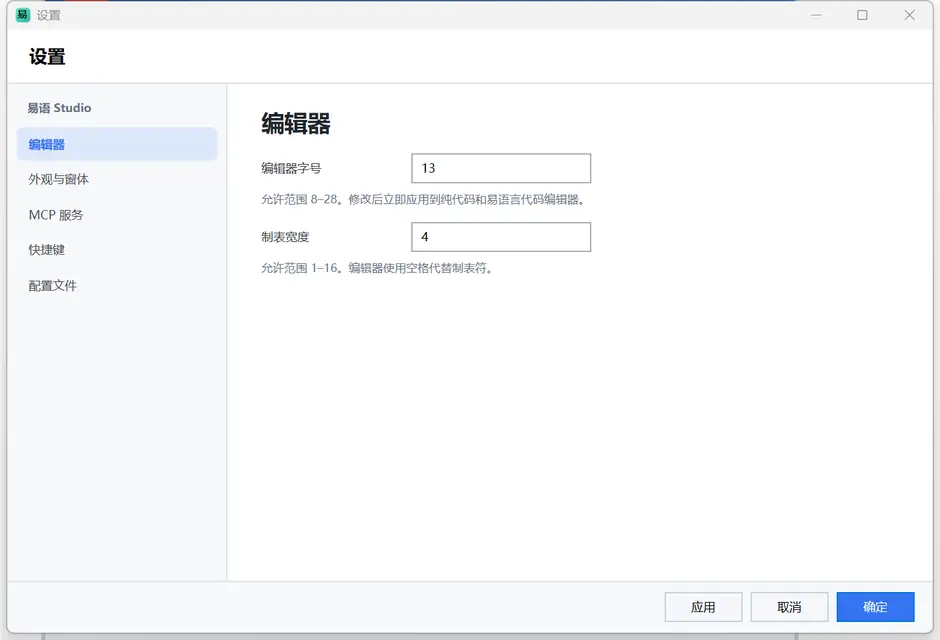

# 易语 Studio

易语 Studio 是一个面向 Windows 的中文桌面开发环境，以现代 IDE 技术重制易语言的开发体验，把界面设计、中文代码编辑、项目管理和应用编译整合在同一个工作区。

项目正在持续开发中，语言能力、文件格式和 IDE 交互都会继续调整。

## 界面

工作区采用现代浅色 IDE 布局：

- 菜单、当前文档标题和窗口按钮共用无系统标题栏的顶部操作栏，窗口仍支持拖动、缩放、双击最大化和贴边布局。
- 左侧显示真实项目目录，可直接展开文件夹、打开窗体、代码和项目文件。
- 右侧提供支持库、程序数据和属性工具窗口。
- 组件箱只在窗体设计器中显示，不会占用代码编辑空间。
- 文档标签位于编辑器顶部，并显示项目路径和当前过程面包屑。
- 状态栏显示运行状态、光标位置和文件编码。
- 代码编辑支持自动补全、参数签名提示、F1 上下文帮助、括号配对、块缩进、折叠和撤销。

### 易语言式代码窗口

每个子程序使用一张紧凑的方法声明表，代码正文在表格下方连续编辑。支持对象/过程导航、语法着色、参数提示、补全和块缩进。


### 窗体设计器

窗体设计器支持组件拖放、属性编辑、画布对齐、事件入口和原生窗口预览。


### MCP 资源示例

下面的界面通过 MCP 接口从空白工程创建：导入窗口图标和图片资源、布局控件、写入按钮事件并运行预览。


## 当前能力

- C# / WPF 原生 Windows IDE，无 Electron、无 WebView。
- 编辑器与命令行编译器分离：`YyStudio.exe` 负责 IDE，`yy.exe` 负责构建、检查和运行。
- 中文标识符、函数、递归、默认参数、类型标注、数组、对象和异常处理。
- AST 解析器、解释执行器、C# 代码生成器和跨文件诊断。
- `.yyproj` 项目管理、模块引入、资源表、常量表和数据表。
- 新建项目必须填写项目名和包名，源码固定在 `Sources/`，资源固定在 `Resources/`。
- 源码子目录可按 `引入 "项目包名.子目录"` 作为目录包导入。
- 可视化窗体设计、组件箱、属性夹、事件绑定和窗口预览。
- 三文件界面模型：`.yyx` 界面、`.Designer.yyc` 自动关系、`.yyc` 用户代码。
- 自动关系文件使用可读的易语声明代码和 `@id/...` 标识，不使用 XML 保存事件。
- JDK 式系统 SDK 包边界、`导入包` 上下文补全和 Swing 式跨 UI 技术契约。
- 易语言式代码窗口和纯代码模式共用同一份用户代码。
- 项目可编译为 Windows 单文件 EXE。
- 条件、`当`循环、`计次循环`、`遍历`、`跳出`和`继续`。
- JSON、文本、集合、文件、时间等内置命令。
- UTF-8 文件、行列诊断、运行输出和可取消执行。

功能规划和边界见 [路线图](docs/roadmap.md) 与 [能力核对](docs/feature-analysis.md)。

## 运行

需要 .NET 10 SDK 与 Windows 10/11。

```powershell
dotnet run --project .\src\Yy.Studio\Yy.Studio.csproj
```

打开 `examples` 文件夹即可加载示例工程。

默认快捷键如下，均可在 `YyStudio.json` 或设置窗口中修改：

- `F5`：运行当前源码或预览当前窗体。
- `Ctrl+F5`：运行项目。
- `Shift+F5`：停止运行。
- `Ctrl+B`：编译项目。
- `Ctrl+S`：保存。
- `Ctrl+W`：关闭当前标签。
- `Ctrl+Space`：代码补全。
- `F1`：当前位置的函数、命令、参数或变量帮助。
- `Ctrl+/`：切换当前行或所选行的注释。
- `Ctrl+D`：复制当前行或所选内容。
- `Ctrl+Shift+K`：删除当前行或所选内容。

代码窗口右上角可切换“易语言代码”和“纯代码”。

新建项目请按 `Ctrl+Alt+N`，填写项目名、包名和项目位置。Studio 会分别创建 `Sources/` 与 `Resources/`，项目清单和界面三文件关系分别见 [项目结构](docs/projects.md) 和 [界面架构](docs/architecture.md)。

## 命令行工具

`yy` 是不加载 WPF 和 IDE 的命令行编译器。开发时可以直接运行：

```powershell
dotnet run --project .\tools\Yy.Cli -- check .\examples\示例.yyproj
dotnet run --project .\tools\Yy.Cli -- build .\examples\示例.yyproj -o .\artifacts\示例.exe
dotnet run --project .\tools\Yy.Cli -- run .\examples\MCP资源演示
```

发布后使用 `yy.exe`：

```powershell
yy build <工程.yyproj|目录> [-o 输出.exe] [--framework-dependent] [--rid RID]
yy check <工程.yyproj|目录>
yy run <工程.yyproj|目录>
```

`YyStudio.exe` 仅负责可视化编辑和 IDE 内操作；脚本、CI 和批处理可直接调用 `yy.exe`。命令行编译目前需要开发机安装 .NET 10 SDK。

## 系统 SDK 与包导入

`Yy.Sdk` 提供类似 JDK 的包边界，当前包含 `系统.基础`、`系统.界面`、`系统.文件` 和 `系统.数据`。源码使用统一语法声明依赖：

```text
.版本 1
.程序集 包示例

导入包 "系统.基础"
导入包 "系统.界面"

取控件("@id/主窗口/保存按钮").文本 = "已保存"
```

界面契约借鉴 Swing 的分层方式，将窗体上下文、界面元素、窗口和控件与 WPF 实现分离。当前 SDK 版本为 `1`；按包限制类型与命令、外部包和包管理器属于后续能力。完整设计见 [系统 SDK](docs/sdk.md)。

系统包与项目源码目录包使用不同关键字：`导入包 "系统.界面"` 引入 SDK，`引入 "demo.tools"` 引入当前项目 `Sources/tools` 目录包。

## Studio 配置

Studio 的可编辑配置保存在 `%APPDATA%\YyStudio\YyStudio.json`。首次启动会自动生成，也可通过“工具 → 打开 Studio 配置文件”直接编辑，完整模板见 [YyStudio.example.json](YyStudio.example.json)。

配置文件覆盖：

- MCP 启用状态、端口、自动寻找端口和尝试次数。
- 编辑器字号、制表宽度和窗体吸附网格。
- 默认编译目标平台与停用支持库。
- 新建、打开、保存、编译、运行、调试、补全、帮助、注释和行编辑快捷键。

设置窗口采用 JetBrains 风格双栏布局。也可以在启动时指定配置：



```powershell
YyStudio.exe --config D:\Config\YyStudio.json --mcp-port 38400
```

详细格式、校验规则和配置优先级见 [Studio 配置](docs/configuration.md)。

## MCP 接口

Studio 内置 MCP（Model Context Protocol）服务端，AI 客户端可以读取 IDE 状态、打开和保存工程、编辑窗体、创建事件、写入子程序、运行预览并触发界面交互。每个 MCP 工具都调用 Studio 的真实编辑流程，与用户在界面中的操作使用同一套代码路径。

IDE 启动后默认在 `http://127.0.0.1:37213/mcp` 提供 HTTP JSON-RPC 接口。默认端口可以在 `YyStudio.json` 中修改，或通过 `--mcp-port` 临时覆盖；项目根目录的 `.mcp.json` 使用默认端点：

```json
{
  "mcpServers": {
    "yy-studio": {
      "type": "http",
      "url": "http://127.0.0.1:37213/mcp"
    }
  }
}
```

如果默认端口被占用，服务会依次尝试后续端口，并将实际端口写入 `%TEMP%\yystudio-mcp.port`。也可以使用标准输入输出传输：

```powershell
YyStudio.exe --mcp-stdio
```

当前提供 19 个工具，覆盖工程创建、资源导入、窗体设计、控件与事件、代码读写、预览运行、控件交互和界面截图。完整参数、请求示例和返回说明见 [MCP 接口文档](docs/mcp.md)。

## 构建发布版

```powershell
.\build.ps1
```

发布结果：

```text
artifacts\publish\YyStudio\YyStudio.exe
artifacts\publish\yy\yy.exe
artifacts\samples\易语示例.exe
```

构建脚本会运行语言测试和编译链烟雾测试，然后生成 Windows x64 自包含版本。

若目标机器已安装 .NET 10 Desktop Runtime，可以生成体积更小的版本：

```powershell
.\build-lite.ps1
```

输出包含 `artifacts\publish\win-x64-framework-dependent\YyStudio.exe` 和
`artifacts\publish\yy-framework-dependent\yy.exe`。

## 工程结构

新建项目的固定结构如下：

```text
DemoProject/
├─ DemoProject.yyproj
├─ Sources/
│  ├─ Program.yyc            项目入口
│  ├─ Forms/
│  │  ├─ MainForm.yyx        界面与布局
│  │  ├─ MainForm.Designer.yyc 自动生成关系
│  │  └─ MainForm.yyc        用户代码
│  └─ 工具/                  可通过 demo.app.工具 导入

Resources/
├─ ids.xml                   自动生成的控件与资源标识
├─ images/                   图片资源
├─ sounds/                   声音资源
└─ files/                    其他文件资源
```

`Resources/ids.xml` 类似 Android 的资源关联表：窗体控件使用 `@id/窗体/控件`，资源使用 `@资源/图片/名称` 形式登记。工程清单通过 `"资源标识": "Resources/ids.xml"` 声明索引，新建项目、保存窗体和资源表时自动同步。

工程清单同时记录 `"包名": "demo.app"`、`"源码目录": "Sources"` 和 `"资源目录": "Resources"`。源码、窗体和入口不能离开 `Sources/`，资源不能离开 `Resources/`。

`.Designer.yyc` 使用 `界面()`、`控件()`、`绑定()` 纯代码声明，不使用 XML。用户代码通过 `取控件("@id/主窗口/保存按钮")` 获取当前界面控件。

示例主窗体使用 `@资源/图片/应用图标` 作为窗口图标，并通过图片框显示 `@资源/图片/客户图标`。设计器、预览和编译后的 EXE 共用同一套资源标识。

```text
src/Yy.Language/          词法、语法树、解析器、解释器和中文标准库
src/Yy.Compiler/          项目模型、窗体协议、资源索引、代码生成和编译器
src/Yy.CompilerRuntime/   编译应用使用的值、控件与标准库运行时
src/Yy.Sdk/               系统包、UI 契约和 SDK 版本
src/Yy.Studio/            WPF 原生 IDE
tools/Yy.Cli/             yy.exe 命令行入口
tests/                    语言与桌面回归测试
examples/                 示例工程
docs/                     格式、架构、编辑器和路线图文档
```

## 代码示例

`.yyc` 以结构化 XML 保存，IDE 同时提供易语言式方法表和纯代码编辑视图。

```text
.版本 1
.程序集 示例

子程序 问候(姓名: 文本 = "世界"): 文本
    返回 "你好，" + 姓名
结束子程序

输出(问候())
```

表达式使用中文易语语法。详细说明见 [语言参考](docs/language.md)、[代码编辑器](docs/code-editor.md) 和 [结构化代码格式](docs/code-format.md)。

## 设计原则

1. **Windows 原生优先**：桌面端使用 WPF，保持原生窗口、输入和文件系统体验。
2. **中文优先**：标识符、关键字、诊断和工程文件都适合中文开发。
3. **界面与逻辑分离**：XML、自动关系代码和用户代码各自承担单一职责。
4. **可视化与纯代码并存**：同一工程可以使用窗体设计器，也可以直接编辑完整源码。
5. **可验证的工程工具链**：解析、执行、编译、保存和编辑器交互都纳入自动测试。
